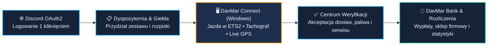

  <!-- 📸 SLOT 00 (LOGO): Jeśli wrzucisz logo do nowego repozytorium (np. assets/davmar-logo.png), podmień src="" poniżej -->
  

  <h1>🚛 System Operacyjny DavMar Polska</h1>

  

    <strong>Kompleksowy, szyty na miarę ekosystem klasy TMS / ERP dla wirtualnej firmy transportowej (Euro Truck Simulator 2)</strong> 
    Strona Wizerunkowa • Panel Kierowcy i Ekonomia • Centrum Zarządzania Flotą • Aplikacja Telemetryczna Windows • Bot Discord z Panelem WWW
  

  

    
    
    
  

   

  

    
    &nbsp;&nbsp;
    
  

   

  <!-- 📸 SLOT 01 (GŁÓWNY BANER / KOLAŻ SYSTEMU — zalecane 1920x1080 lub 1600x900): podmień src="" na np. assets/01-hero-showcase.png -->
  
  
✨ <em>Jeden spójny ekosystem łączący kierowców w trasie, dyspozytornię, wirtualną bankowość oraz społeczność Discord.</em>

---

## 🎯 O Projekcie — Cyfrowa Transformacja Wirtualnej Spedycji

Prowadzenie nowoczesnej, dynamicznie rosnącej firmy w **Euro Truck Simulator 2** to dziś znacznie więcej niż wspólna jazda na serwerze. Przy większym zespole tradycyjne arkusze kalkulacyjne, ręczne liczenie kilometrów i porozrzucane kanały na Discordzie szybko stają się wąskim gardłem.

**System DavMar Polska** został zaprojektowany od zera jako **kompletne, autorskie oprogramowanie klasy TMS / ERP**, które automatyzuje każdy etap życia firmy — od pierwszego kontaktu kandydata na stronie internetowej, przez planowanie tras i automatyczny pobór telemetrii prosto z gry w aplikacji Windows, aż po dynamiczną giełdę towarową, wewnętrzny bank i miesięczne rozliczenia kadry.

<table width="100%">
  <tr>
    <td width="25%" align="center" valign="top">
        
      <strong>Jeden Ekosystem</strong> 
      Strona WWW, Panel Kierowcy, Panel Zarządu, aplikacja desktopowa Windows oraz zintegrowany Bot Discord.
    </td>
    <td width="25%" align="center" valign="top">
        
      <strong>Zero Ręcznego Liczenia</strong> 
      Bezpośredni odczyt danych z silnika ETS2, wykrywanie dostaw i tankowań, cyfrowy tachograf oraz mapa GPS na żywo.
    </td>
    <td width="25%" align="center" valign="top">
        
      <strong>Własny Rynek i Bank</strong> 
      Codzienne notowania Giełdy Ładunków, zlecenia specjalne, Sklep Firmowy, automatyczne wyliczenia płac i DavMar Bank.
    </td>
    <td width="25%" align="center" valign="top">
        
      <strong>Bezpieczeństwo i Ład</strong> 
      Logowanie jednym kliknięciem przez Discord OAuth2, precyzyjny podział ról i uprawnień oraz pełny dziennik audytu.
    </td>
  </tr>
</table>

---

## ⚡ Dlaczego Dedykowany System? (Przed vs Po Wdrożeniu)

Zamiast dopasowywać firmę do ograniczeń darmowych narzędzi, **oprogramowanie zostało uszyte w 100% pod procesy i zasady DavMar Polska**:

<table width="100%">
  <thead>
    <tr>
      <th width="50%" align="left">❌ Tradycyjne podejście (Arkusze &amp; Ręczne raporty)</th>
      <th width="50%" align="left">✅ Dedykowany Ekosystem DavMar Polska</th>
    </tr>
  </thead>
  <tbody>
    <tr>
      <td>Kierowcy ręcznie przepisują kilometry i szukają swoich przydziałów na czatach tekstowych.</td>
      <td><strong>Automatyczna telemetria DavMar Connect</strong> sczytuje przejechany dystans prosto z gry i łączy go z aktywną rozpiską kierowcy.</td>
    </tr>
    <tr>
      <td>Dyspozytorzy tracą godziny na sprawdzanie, jakim zestawem jedzie dany pracownik i czy ładunek pasuje do naczepy.</td>
      <td><strong>Inteligentny moduł Floty i Rozpisek</strong> pilnuje przypisanych ciągników, naczep oraz kompatybilności ładunków z katalogami ETS2 i ProMods.</td>
    </tr>
    <tr>
      <td>Mozolne, podatne na błędy podliczanie wypłat, premii i kosztów paliwa pod koniec każdego miesiąca.</td>
      <td><strong>Silnik Ekonomii i DavMar Bank</strong> wyliczają stawki na podstawie kursów i notowań giełdowych oraz generują gotowe zestawienia miesięczne.</td>
    </tr>
    <tr>
      <td>Brak widoczności tego, co dzieje się na trasie, oraz rozproszone zgłoszenia napraw czy tankowań.</td>
      <td><strong>Mapa Floty na Żywo (Live GPS)</strong> oraz <strong>jedna centralna kolejka Wniosków</strong> z systemem powiadomień i komentarzy zwrotnych.</td>
    </tr>
    <tr>
      <td>Konfiguracja bota Discord poprzez skomplikowane komendy tekstowe i kopiowanie identyfikatorów kanałów.</td>
      <td><strong>Autorski Panel WWW Bota</strong> z wybieraniem ról i kanałów z list rozwijanych oraz edycją wiadomości na żywo bez duplikatów.</td>
    </tr>
  </tbody>
</table>

---

## 🔄 Jak Działa Ekosystem w Praktyce?

Wszystkie elementy platformy wymieniają dane w czasie rzeczywistym, tworząc zamknięty i intuicyjny obieg pracy dla całego zespołu:

---

## 🧩 Poznaj 5 Filarów Systemu DavMar Polska

 

###  Nowoczesna Wizytówka Marki (`Landing Page`)

Pierwszy punkt styku kandydata i partnera z firmą. Zaprojektowana w autorskiej stylistyce **Steel-Navy & Electric Cyan**, buduje wizerunek profesjonalnej marki transportowej od pierwszej sekundy.

- **Interaktywna Scena Hero i Animowana Mapa Europy** — dynamiczna wizualizacja sieci połączeń, efekt świetlny podążający za kursorem oraz autorska grafika firmowego zestawu ciężarowego.
- **Galeria Społeczności na Żywo z Discorda** — strona automatycznie pobiera i prezentuje najnowsze zdjęcia z tras publikowane przez kierowców na kanale firmowym, z podglądem pełnoekranowym (Lightbox).
- **Adaptacyjna Wydajność (Smart FX)** — interfejs sam monitoruje płynność animacji w przeglądarce użytkownika i automatycznie dopasowuje efekty wizualne, gwarantując płynne działanie na każdym komputerze i smartfonie.
- **Ścieżka Rekrutacji Krok po Kroku & Sekcja FAQ** — przejrzyste przeprowadzenie kandydata od wejścia na stronę aż po dołączenie na Discord i otwarcie Panelu Kierowcy.

<table width="100%">
  <tr>
    <td width="50%" align="center" valign="top">
      <!-- 📸 SLOT 02: podmień src="" na np. assets/02-landing-hero.png -->
      
      <strong>Sekcja powitalna (Hero)</strong> — interaktywna mapa tras w Europie i szybkie przejście do panelu oraz rekrutacji.
    </td>
    <td width="50%" align="center" valign="top">
      <!-- 📸 SLOT 03: podmień src="" na np. assets/03-landing-galeria-oferta.png -->
      
      <strong>Automatyczna galeria i oferta firmy</strong> — zdjęcia z tras pobierane z Discorda oraz animowane stanowisko pielęgnacji zestawu.
    </td>
  </tr>
</table>

 

---

 

###  Osobiste Centrum Dowodzenia Pracownika (`Driver Portal`)

Po zalogowaniu przez Discord pracownik trafia do przejrzystego panelu webowego, w którym ma pod ręką wszystkie informacje o swojej pracy, finansach i statystykach.

- **Kokpit „Moja Praca”** — podgląd aktualnie przypisanego zestawu (ciągnik + naczepa), aktywnej rozpiski odcinków do przejechania, statusów wysłanych raportów dostaw ze zrzutami podsumowań oraz rejestru paliwa i wydatków.
- **Dynamiczna Giełda Ładunków i Zlecenia Specjalne** — żyjący rynek towarów z codziennie aktualizowanymi mnożnikami cenowymi i 30-dniową historią notowań. Kierowcy mogą jednym kliknięciem przejmować globalne **Zlecenia Specjalne** o podwyższonej stawce, które automatycznie dopisują się do ich rozpiski.
- **DavMar Bank (Wewnętrzny System Bankowości)** — indywidualne konto rozliczeniowe każdego pracownika prowadzone w PLN, automatyczne księgowanie wypłat, tankowań i zakupów, powiadomienia o operacjach oraz **błyskawiczne przelewy wewnętrzne między kierowcami**.
- **Sklep Firmowy, Serwis Zestawu i Statystyki** — katalog dodatków firmowych ze stałą lub zmienną ceną rynkową, formularz zgłaszania napraw zestawu z dokumentacją oraz rankingi przebiegu, przewiezionego tonażu i średniego spalania.

<table width="100%">
  <tr>
    <td width="50%" align="center" valign="top">
      <!-- 📸 SLOT 04: podmień src="" na np. assets/04-panel-moja-praca.png -->
      
      <strong>Widok „Moja Praca”</strong> — aktualna rozpiska, przypisany zestaw i status weryfikacji każdej dostawy.
    </td>
    <td width="50%" align="center" valign="top">
      <!-- 📸 SLOT 05: podmień src="" na np. assets/05-panel-gielda-ladunkow.png -->
      
      <strong>Giełda Ładunków</strong> — dzienne mnożniki towarów, wykresy trendów oraz przejmowanie Zleceń Specjalnych.
    </td>
  </tr>
  <tr>
    <td width="50%" align="center" valign="top">
      <!-- 📸 SLOT 06: podmień src="" na np. assets/06-panel-davmar-bank.png -->
      
      <strong>DavMar Bank</strong> — przejrzyste saldo, pełna historia wpływów i obciążeń oraz przelewy między pracownikami.
    </td>
    <td width="50%" align="center" valign="top">
      <!-- 📸 SLOT 07: podmień src="" na np. assets/07-panel-sklep-statystyki.png -->
      
      <strong>Sklep Firmowy i Statystyki</strong> — zamówienia dodatków z notowaniami cen oraz zestawienia kilometrów, tonażu i spalania.
    </td>
  </tr>
</table>

 

---

 

###  Centrum Operacyjne Kadry Zarządzającej (`Fleet Admin / TMS`)

Rozbudowany moduł administracyjny dla **Dyspozytorów, Zarządu oraz działu IT**, w którym uprawnienia są rygorystycznie weryfikowane po stronie serwera.

- **Mapa Floty na Żywo (`Live Map`)** — interaktywna mapa Europy wyświetlająca bieżące położenie kierowców aktywnych w grze w czasie rzeczywistym, z poszanowaniem prywatności (system prezentuje wyłącznie aktualny punkt w trakcie jazdy bez gromadzenia historycznych śladów trasy).
- **Katalog Floty i Przydziały Zestawów** — pełna baza firmowych ciągników siodłowych i naczep wraz ze zdjęciami, opisami, archiwizacją oraz przypisywaniem kompletnych zestawów konkretnym kierowcom.
- **Kreator Rozpisek z Walidacją Katalogów Gry** — układanie wieloetapowych tras w oparciu o słowniki miast, państw i spedycji z **ETS2 oraz ProMods**, z automatyczną blokadą niezgodnych połączeń ładunku z typem naczepy (np. chłodnia vs firanka).
- **Centralna Kolejka Wniosków i Rozliczenia Miesięczne** — jedno okno decyzyjne do sprawdzania dostaw, tankowań, napraw i próśb o zakupy (z wymogiem podania powodu przy odrzuceniu), generator miesięcznych projektów wypłat oraz **Dziennik Zdarzeń (`Audit Log`)** rejestrujący kluczowe operacje administracyjne.

  <!-- 📸 SLOT 08: podmień src="" na np. assets/08-admin-mapa-na-zywo.png -->
  
  
<strong>Mapa Floty na Żywo</strong> — podgląd aktywnych zestawów realizujących zlecenia na drogach Europy w czasie rzeczywistym.

<table width="100%">
  <tr>
    <td width="50%" align="center" valign="top">
      <!-- 📸 SLOT 09: podmień src="" na np. assets/09-admin-flota-rozpiski.png -->
      
      <strong>Katalog Floty i Rozpiski</strong> — zarządzanie parkiem maszynowym, przydziałami kierowców i planowaniem kolejnych tras.
    </td>
    <td width="50%" align="center" valign="top">
      <!-- 📸 SLOT 10: podmień src="" na np. assets/10-admin-wnioski-rozliczenia.png -->
      
      <strong>Kolejka Wniosków i Płace</strong> — błyskawiczna weryfikacja raportów kierowców oraz zatwierdzanie miesięcznych rozliczeń firmy.
    </td>
  </tr>
</table>

 

---

 

###  Natywny Klient Telemetryczny (`DavMar Connect` + `DavMar Setup`)

Dedykowana aplikacja desktopowa dla systemu Windows napisana w **C# / .NET 8**, zaprojektowana w spójnej ciemnej stylistyce całego ekosystemu. Łączy kokpit ciężarówki w Euro Truck Simulator 2 bezpośrednio z chmurą firmy.

- **Bezpośredni Odczyt Telemetrii SCS** — aplikacja wykrywa załadowane zlecenie oraz moment ukończenia dostawy, dopasowuje odcinek z rozpiski i pozwala przekazać rzeczywisty dystans prosto ze źródła telemetrycznego gry.
- **Wbudowany Cyfrowy Tachograf** — pilnuje firmowych norm czasu prowadzenia pojazdu i wymaganych przerw postojowych na czytelnym zegarze kierowcy.
- **Inteligentna Obsługa Paliwa, Napraw i Myjni** — automatyczne wykrywanie tankowania w grze z wyliczeniem realnego średniego spalania (na podstawie drogomierza i poziomu baku) oraz wyceną według rynkowych cen hurtowych/detalicznych paliwa, a także wbudowany moduł zgłaszania napraw i historii mycia zestawu.
- **Kolejka Offline, Parowanie Urządzeń i Cichy Auto-Updater** — autoryzacja komputera jednym kliknięciem przez Discord (z opcją zdalnego odłączenia urządzenia w ustawieniach konta), bezpieczna kolejka lokalna chroniąca raporty przy utracie internetu oraz **własny program instalacyjny `DavMar Setup`**, który pobiera i instaluje aktualizacje w tle, nie przerywając trwającego kursu w grze.

  <!-- 📸 SLOT 11: podmień src="" na np. assets/11-connect-praca-telemetria.png -->
  
  
<strong>DavMar Connect dla Windows</strong> — nowoczesny interfejs kierowcy z podglądem stanu połączenia z ETS2, rozpiską i obsługą dostaw.

<table width="100%">
  <tr>
    <td width="50%" align="center" valign="top">
      <!-- 📸 SLOT 12: podmień src="" na np. assets/12-connect-tachograf-serwis.png -->
      
      <strong>Tachograf i Eksploatacja</strong> — kontrola przerw kierowcy, potwierdzanie wykrytych tankowań, wnioski serwisowe i dziennik myjni.
    </td>
    <td width="50%" align="center" valign="top">
      <!-- 📸 SLOT 13: podmień src="" na np. assets/13-connect-instalator.png -->
      
      <strong>Autorski DavMar Setup</strong> — dedykowany instalator z weryfikacją integralności paczek i bezobsługowymi aktualizacjami.
    </td>
  </tr>
</table>

 

---

 

###  Zintegrowany Bot Społecznościowy (`DavMar Bot`)

Serwer Discord to serce komunikacji każdej firmy w ETS2 — dlatego ekosystem uzupełnia dedykowany bot zarządzany w całości z poziomu eleganckiego panelu w przeglądarce.

- **Webowy Panel Administracyjny Bota** — logowanie przez Discord i pełna konfiguracja wszystkich funkcji z użyciem wygodnych list wyboru kanałów i ról (zero ręcznego kopiowania ID). Po zapisaniu ustawień bot **automatycznie aktualizuje swoje istniejące wiadomości na serwerze**, nie tworząc bałaganu.
- **Zaawansowany System Ticketów (Rekrutacja & Pomoc)** — interaktywne formularze zgłoszeniowe, automatyczne tworzenie prywatnych kanałów dla wybranych ról kadry oraz zapisywanie pełnych transkryptów rozmów po zamknięciu zgłoszenia.
- **Weryfikacja Regulaminu, Strefa Partnerów i Powitania** — samoobsługowe przyciski nadające role po akceptacji zasad, panele ról dla przedstawicieli firm partnerskich oraz spersonalizowane karty powitań i pożegnań.
- **Automatyczny Czytnik Bloga SCS Software (RSS)** — cykliczne monitorowanie oficjalnych aktualności twórców gry i publikowanie bogato ilustrowanych powiadomień dla społeczności.

<table width="100%">
  <tr>
    <td width="50%" align="center" valign="top">
      <!-- 📸 SLOT 14: podmień src="" na np. assets/14-bot-panel-www.png -->
      
      <strong>Panel Konfiguracji WWW</strong> — intuicyjne zarządzanie każdym modułem bota bez znajomości komend technicznych.
    </td>
    <td width="50%" align="center" valign="top">
      <!-- 📸 SLOT 15: podmień src="" na np. assets/15-bot-discord-widok.png -->
      
      <strong>Obsługa Serwera Discord</strong> — estetyczne karty embed, formularze rekrutacyjne, transkrypty i automatyczne newsy SCS.
    </td>
  </tr>
</table>

---

## 🎨 Spójna Identyfikacja Wizualna & Technologia

Cały projekt — od publicznej strony internetowej, przez panel kierowcy i dashboard bota, aż po okienkową aplikację Windows — został utrzymany w **jednym, rozpoznawalnym systemie stylistycznym**:

  

    
    
    
    
    
  

  
Typografia interfejsów: <strong>Space Grotesk</strong> (nagłówki ekspozycyjne) • <strong>Inter</strong> (ergonomia UI) • <strong>JetBrains Mono</strong> (dane telemetryczne i finansowe)

<table width="100%">
  <thead>
    <tr>
      <th width="25%" align="left">Warstwa Frontend &amp; UI</th>
      <th width="25%" align="left">Backend &amp; Logika Biznesowa</th>
      <th width="25%" align="left">Klient Desktopowy Windows</th>
      <th width="25%" align="left">Integracje &amp; Jakość</th>
    </tr>
  </thead>
  <tbody>
    <tr>
      <td valign="top">
        • React 19 &amp; TypeScript 
        • Tailwind CSS v4 &amp; Vite 
        • MapLibre GL (mapy wektorowe) 
        • Dostępność (WCAG) &amp; RWD
      </td>
      <td valign="top">
        • Node.js &amp; Express 
        • Relacyjna baza SQLite + migracje 
        • Walidacja schematów Zod 
        • Kontrola ról RBAC &amp; Audyt
      </td>
      <td valign="top">
        • C# &amp; platforma .NET 8 
        • Integracja z telemetrią SCS 
        • Autorski instalator DavMar Setup 
        • Lokalna kolejka odporna na offline
      </td>
      <td valign="top">
        • Discord.js &amp; Discord OAuth2 
        • Konteneryzacja Docker 
        • Automatyczne pipeline'y CI/CD 
        • Rozbudowany zestaw testów
      </td>
    </tr>
  </tbody>
</table>

---

## 🤝 Chcesz Podobny System dla Swojej Firmy lub Projektu?

Podoba Ci się sposób, w jaki **System DavMar Polska** łączy nowoczesny design z realną automatyzacją pracy?

Projektuję i buduję **dedykowane oprogramowanie na zamówienie** — od pierwszej koncepcji biznesowej i projektu interfejsu, przez backend i aplikacje desktopowe, aż po wdrożenie na serwer i wsparcie techniczne. Bez gotowych, ograniczających szablonów — otrzymujesz rozwiązanie dopasowane w 100% do Twoich procesów i wizerunku marki.

<table width="100%">
  <tr>
    <td width="50%" valign="top">
      <h4>💼 Co mogę dla Ciebie zbudować?</h4>
      <ul>
        <li><strong>Systemy Webowe, Panele CRM / ERP / TMS</strong> — panele pracowników, klientów, dyspozytorni, rozliczeń, magazynu czy floty.</li>
        <li><strong>Nowoczesne Strony Firmowe i Landing Page'e</strong> — szybkie, dopracowane wizualnie strony sprzedażowe i rekrutacyjne z autorskimi animacjami.</li>
        <li><strong>Aplikacje Desktopowe dla Windows (C# / .NET)</strong> — dedykowane programy narzędziowe, integracje z telemetrią gier, sprzętem i zewnętrznymi API.</li>
        <li><strong>Zaawansowane Boty Discord z Panelami WWW</strong> — systemy ticketów, weryfikacji, ekonomii i automatyzacji społeczności połączone z bazą danych.</li>
      </ul>
    </td>
    <td width="50%" valign="top">
      <h4>🚀 Dlaczego warto porozmawiać?</h4>
      <ul>
        <li><strong>Kompleksowa realizacja od A do Z</strong> — jeden wykonawca odpowiedzialny za całość: WWW, serwer, aplikację Windows i integracje.</li>
        <li><strong>Nacisk na UX i nowoczesną estetykę</strong> — oprogramowanie, z którego Twój zespół i klienci naprawdę chcą codziennie korzystać.</li>
        <li><strong>Bezpieczeństwo i skalowalność</strong> — solidna architektura, autoryzacja użytkowników, kopie zapasowe i testy automatyczne.</li>
        <li><strong>Jasna komunikacja i doradztwo</strong> — pomogę przełożyć Twój pomysł na konkretne moduły dopasowane do budżetu.</li>
      </ul>
    </td>
  </tr>
</table>

 

  <h3>📩 Skontaktuj się i wyceń swój projekt bezpłatnie</h3>
  
Opisz krótko, czego potrzebujesz — wspólnie dobierzemy najlepsze rozwiązanie i zakres wdrożenia.

  <table width="80%">
    <tr>
      <td width="50%" align="center" valign="middle">
         
        <strong>🌐 Strona i Portfolio Autora</strong>  
        
          
        Bezpośredni link: <a href="https://drwilkor.fly.dev/">https://drwilkor.fly.dev/</a>
          
      </td>
      <td width="50%" align="center" valign="middle">
         
        <strong>💬 Bezpośredni Kontakt na Discordzie</strong>  
        
          
        Discord ID (kliknij, aby skopiować): <code>446740090757316608</code>
          
      </td>
    </tr>
  </table>

 

---

  
    <strong>System Operacyjny DavMar Polska</strong> • Prezentacja projektu (Public Showcase) 
    Architektura, projekt UI/UX i kompleksowe wykonanie: <a href="https://drwilkor.fly.dev/"><strong>DrWilkor</strong></a> • Discord ID: <code>446740090757316608</code>
  

