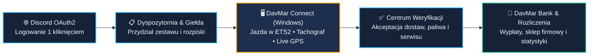

  

  <h1>🚛 System Operacyjny DavMar Polska</h1>

  

    <strong>Kompleksowy, szyty na miarę ekosystem klasy TMS / ERP dla wirtualnej firmy transportowej (Euro Truck Simulator 2)</strong> 
    Strona Wizerunkowa • Panel Kierowcy i Ekonomia • Centrum Zarządzania Flotą • Aplikacja Telemetryczna Windows • Bot Discord z Panelem WWW
  

  

    
    
    
  

   

  

    
    &nbsp;&nbsp;
    
    &nbsp;&nbsp;
    
  

---

## 🎯 O Projekcie — Cyfrowa Transformacja Wirtualnej Spedycji

Prowadzenie nowoczesnej, dynamicznie rosnącej firmy w **Euro Truck Simulator 2** to dziś znacznie więcej niż wspólna jazda na serwerze. Przy większym zespole tradycyjne arkusze kalkulacyjne, ręczne liczenie kilometrów i porozrzucane kanały na Discordzie szybko stają się wąskim gardłem.

**System DavMar Polska** został zaprojektowany od zera jako **kompletne, autorskie oprogramowanie klasy TMS / ERP**, które automatyzuje każdy etap życia firmy — od pierwszego kontaktu kandydata na stronie internetowej, przez planowanie tras i automatyczny pobór telemetrii prosto z gry w aplikacji Windows, aż po dynamiczną giełdę towarową, wewnętrzny bank i miesięczne rozliczenia kadry.

<table width="100%">
  <tr>
    <td width="25%" align="center" valign="top">
        
      <strong>Jeden Ekosystem</strong> 
      Strona WWW, Panel Kierowcy, Panel Zarządu, aplikacja desktopowa Windows oraz zintegrowany Bot Discord.
    </td>
    <td width="25%" align="center" valign="top">
        
      <strong>Zero Ręcznego Liczenia</strong> 
      Bezpośredni odczyt danych z silnika ETS2, wykrywanie dostaw i tankowań, cyfrowy tachograf oraz mapa GPS na żywo.
    </td>
    <td width="25%" align="center" valign="top">
        
      <strong>Własny Rynek i Bank</strong> 
      Codzienne notowania Giełdy Ładunków, zlecenia specjalne, Sklep Firmowy, automatyczne wyliczenia płac i DavMar Bank.
    </td>
    <td width="25%" align="center" valign="top">
        
      <strong>Bezpieczeństwo i Ład</strong> 
      Logowanie jednym kliknięciem przez Discord OAuth2, precyzyjny podział ról i uprawnień oraz pełny dziennik audytu.
    </td>
  </tr>
</table>

---

## ⚡ Dlaczego Dedykowany System? (Przed vs Po Wdrożeniu)

Zamiast dopasowywać firmę do ograniczeń darmowych narzędzi, **oprogramowanie zostało uszyte w 100% pod procesy i zasady DavMar Polska**:

<table width="100%">
  <thead>
    <tr>
      <th width="50%" align="left">❌ Tradycyjne podejście (Arkusze &amp; Ręczne raporty)</th>
      <th width="50%" align="left">✅ Dedykowany Ekosystem DavMar Polska</th>
    </tr>
  </thead>
  <tbody>
    <tr>
      <td>Kierowcy ręcznie przepisują kilometry i szukają swoich przydziałów na czatach tekstowych.</td>
      <td><strong>Automatyczna telemetria DavMar Connect</strong> sczytuje przejechany dystans prosto z gry i łączy go z aktywną rozpiską kierowcy.</td>
    </tr>
    <tr>
      <td>Dyspozytorzy tracą godziny na sprawdzanie, jakim zestawem jedzie dany pracownik i czy ładunek pasuje do naczepy.</td>
      <td><strong>Inteligentny moduł Floty i Rozpisek</strong> pilnuje przypisanych ciągników, naczep oraz kompatybilności ładunków z katalogami ETS2 i ProMods.</td>
    </tr>
    <tr>
      <td>Mozolne, podatne na błędy podliczanie wypłat, premii i kosztów paliwa pod koniec każdego miesiąca.</td>
      <td><strong>Silnik Ekonomii i DavMar Bank</strong> wyliczają stawki na podstawie kursów i notowań giełdowych oraz generują gotowe zestawienia miesięczne.</td>
    </tr>
    <tr>
      <td>Brak widoczności tego, co dzieje się na trasie, oraz rozproszone zgłoszenia napraw czy tankowań.</td>
      <td><strong>Mapa Floty na Żywo (Live GPS)</strong> oraz <strong>jedna centralna kolejka Wniosków</strong> z systemem powiadomień i komentarzy zwrotnych.</td>
    </tr>
    <tr>
      <td>Konfiguracja bota Discord poprzez skomplikowane komendy tekstowe i kopiowanie identyfikatorów kanałów.</td>
      <td><strong>Autorski Panel WWW Bota</strong> z wybieraniem ról i kanałów z list rozwijanych oraz edycją wiadomości na żywo bez duplikatów.</td>
    </tr>
  </tbody>
</table>

---

## 🔄 Jak Działa Ekosystem w Praktyce?

Wszystkie elementy platformy wymieniają dane w czasie rzeczywistym, tworząc zamknięty i intuicyjny obieg pracy dla całego zespołu:

---

## 🧩 Poznaj 5 Filarów Systemu DavMar Polska

 

###  Nowoczesna Wizytówka Marki (`Landing Page`)

Pierwszy punkt styku kandydata i partnera z firmą — dostępny na żywo pod adresem **[https://davmar.fly.dev/](https://davmar.fly.dev/)**. Zaprojektowana w autorskiej stylistyce **Steel-Navy & Electric Cyan**, buduje wizerunek profesjonalnej marki transportowej od pierwszej sekundy.

- **Interaktywna Scena Hero i Animowana Mapa Europy** — dynamiczna wizualizacja sieci połączeń, efekt świetlny podążający za kursorem oraz autorska grafika firmowego zestawu ciężarowego i stanowiska myjni.
- **Galeria Społeczności na Żywo z Discorda** — strona automatycznie pobiera i prezentuje najnowsze zdjęcia z tras publikowane przez kierowców na kanale firmowym, z podglądem pełnoekranowym (Lightbox).
- **Adaptacyjna Wydajność (Smart FX) & Rekrutacja** — interfejs sam dopasowuje płynność animacji do urządzenia użytkownika i prowadzi kandydata krok po kroku do rekrutacji oraz Panelu Kierowcy.

  <!-- 📸 ZDJĘCIE 1 (STRONA GŁÓWNA): podmień src="" poniżej na np. assets/01-strona-glowna.png -->
  
  
🌐 <strong>Publiczna strona firmy (<a href="https://davmar.fly.dev/">davmar.fly.dev</a>)</strong> — wizytówka marki, animowana mapa Europy i automatyczna galeria zdjęć z Discorda.

 

---

 

###  Centrum Operacyjne Kierowców, Dyspozytorni i Zarządu

Po zalogowaniu przez Discord aplikacja webowa automatycznie dopasowuje widok do roli użytkownika — od przejrzystego kokpitu kierowcy po zaawansowane narzędzia TMS/ERP dla kadry zarządzającej.

<table width="100%">
  <tr>
    <td width="50%" valign="top">
      <h4>👨‍✈️ Moduł 02: Panel Kierowcy i Ekonomia</h4>
      <ul>
        <li><strong>Kokpit „Moja Praca”</strong> — aktywna rozpiska tras, przypisany ciągnik i naczepa oraz statusy wysłanych dostaw i wydatków.</li>
        <li><strong>Dynamiczna Giełda Ładunków</strong> — 30-dniowe notowania rynkowe towarów oraz globalne <em>Zlecenia Specjalne</em> przejmowane jednym kliknięciem.</li>
        <li><strong>DavMar Bank</strong> — wewnętrzne konto pracownika w PLN, księgowanie wypłat i tankowań oraz <strong>przelewy między kierowcami</strong>.</li>
        <li><strong>Sklep Firmowy, Naprawy i Statystyki</strong> — zamówienia dodatków ze zmienną ceną, zgłoszenia serwisowe i rankingi spalania oraz tonażu.</li>
      </ul>
    </td>
    <td width="50%" valign="top">
      <h4>🏢 Moduł 03: Dyspozytornia i Panel Zarządu</h4>
      <ul>
        <li><strong>Mapa Floty na Żywo (Live GPS)</strong> — podgląd aktualnej pozycji kierowców aktywnych w grze na mapie Europy w czasie rzeczywistym.</li>
        <li><strong>Katalog Floty i Przydziały</strong> — pełna baza ciągników i naczep ze zdjęciami oraz przypisywaniem zestawów pracownikom.</li>
        <li><strong>Inteligentny Kreator Rozpisek</strong> — słowniki miast i firm z ETS2 oraz ProMods z kontrolą zgodności ładunków z typem naczepy.</li>
        <li><strong>Kolejka Wniosków, Płace i Audyt</strong> — weryfikacja dostaw, paliwa i napraw w jednym miejscu, miesięczne rozliczenia oraz <em>Dziennik Zdarzeń</em>.</li>
      </ul>
    </td>
  </tr>
  <tr>
    <td width="50%" align="center" valign="top">
      <!-- 📸 ZDJĘCIE 2 (PANEL KIEROWCY): podmień src="" poniżej na np. assets/02-panel-kierowcy.png -->
      
      <strong>Widok Pracownika</strong> — rozpiski, Giełda Ładunków, DavMar Bank oraz statystyki.
    </td>
    <td width="50%" align="center" valign="top">
      <!-- 📸 ZDJĘCIE 3 (PANEL ZARZĄDU / FLOTY): podmień src="" poniżej na np. assets/03-panel-zarzadu.png -->
      
      <strong>Widok Kadry (Dyspozytor / Zarząd / IT)</strong> — zarządzanie flotą, wnioskami i mapą na żywo.
    </td>
  </tr>
</table>

 

---

 

###  Natywny Klient Telemetryczny (`DavMar Connect` + `DavMar Setup`)

Autorska aplikacja dla systemu Windows zbudowana w **C# / .NET 8**, utrzymana w ciemnej stylistyce całego systemu. Łączy ciężarówkę w Euro Truck Simulator 2 bezpośrednio z serwerem firmy.

- **Bezpośredni Odczyt Telemetrii SCS** — wykrywanie załadunków i ukończonych dostaw w grze, dopasowanie odcinka z rozpiski oraz przesyłanie rzeczywistego dystansu bez ręcznego wpisywania kilometrów.
- **Cyfrowy Tachograf i Eksploatacja Zestawu** — wbudowany zegar czasu jazdy i przerw postojowych, automatyczna detekcja tankowania z wyliczeniem realnego spalania oraz moduły zgłoszeń napraw i myjni.
- **Praca Offline i Autorski Auto-Updater (`DavMar Setup`)** — parowanie komputera jednym kliknięciem przez Discord, lokalna kolejka chroniąca dane przy braku internetu oraz własny instalator aktualizujący aplikację w tle.

  <!-- 📸 ZDJĘCIE 4 (APLIKACJA WINDOWS DAVMAR CONNECT): podmień src="" poniżej na np. assets/04-davmar-connect.png -->
  
  
🖥️ <strong>DavMar Connect dla Windows</strong> — telemetria ETS2 w czasie rzeczywistym, cyfrowy tachograf, tankowania i obsługa zestawu.

 

---

 

###  Zintegrowany Bot Społecznościowy (`DavMar Bot`)

Ekosystem dopełnia dedykowany bot Discord z własnym panelem konfiguracyjnym w przeglądarce — zero wpisywania komend i ręcznego kopiowania identyfikatorów kanałów.

<table width="100%">
  <tr>
    <td width="50%" valign="top">
      <strong>🎛️ Webowy Panel Administracyjny Bota</strong> 
      Logowanie przez Discord, wygodne listy rozwijane kanałów i ról oraz natychmiastowa edycja wysłanych już wiadomości bota na serwerze bez tworzenia duplikatów.
    </td>
    <td width="50%" valign="top">
      <strong>🎫 Tickety, Weryfikacja i Newsy SCS (RSS)</strong> 
      Formularze rekrutacyjne i pomocowe z automatycznymi transkryptami rozmów, akceptacja regulaminu, strefa partnerów oraz automatyczne powiadomienia z bloga SCS Software.
    </td>
  </tr>
</table>

---

## 🎨 Spójna Identyfikacja Wizualna & Technologia

Cały projekt — od publicznej strony internetowej, przez panel kierowcy i dashboard bota, aż po okienkową aplikację Windows — został utrzymany w **jednym, rozpoznawalnym systemie stylistycznym**:

  

    
    
    
    
    
  

  
Typografia interfejsów: <strong>Space Grotesk</strong> (nagłówki ekspozycyjne) • <strong>Inter</strong> (ergonomia UI) • <strong>JetBrains Mono</strong> (dane telemetryczne i finansowe)

<table width="100%">
  <thead>
    <tr>
      <th width="25%" align="left">Warstwa Frontend &amp; UI</th>
      <th width="25%" align="left">Backend &amp; Logika Biznesowa</th>
      <th width="25%" align="left">Klient Desktopowy Windows</th>
      <th width="25%" align="left">Integracje &amp; Jakość</th>
    </tr>
  </thead>
  <tbody>
    <tr>
      <td valign="top">
        • React 19 &amp; TypeScript 
        • Tailwind CSS v4 &amp; Vite 
        • MapLibre GL (mapy wektorowe) 
        • Dostępność (WCAG) &amp; RWD
      </td>
      <td valign="top">
        • Node.js &amp; Express 
        • Relacyjna baza SQLite + migracje 
        • Walidacja schematów Zod 
        • Kontrola ról RBAC &amp; Audyt
      </td>
      <td valign="top">
        • C# &amp; platforma .NET 8 
        • Integracja z telemetrią SCS 
        • Autorski instalator DavMar Setup 
        • Lokalna kolejka odporna na offline
      </td>
      <td valign="top">
        • Discord.js &amp; Discord OAuth2 
        • Konteneryzacja Docker 
        • Automatyczne pipeline'y CI/CD 
        • Rozbudowany zestaw testów
      </td>
    </tr>
  </tbody>
</table>

---

## 🤝 Chcesz Podobny System dla Swojej Firmy lub Projektu?

Podoba Ci się sposób, w jaki **System DavMar Polska** łączy nowoczesny design z realną automatyzacją pracy?

Projektuję i buduję **dedykowane oprogramowanie na zamówienie** — od pierwszej koncepcji biznesowej i projektu interfejsu, przez backend i aplikacje desktopowe, aż po wdrożenie na serwer i wsparcie techniczne. Bez gotowych, ograniczających szablonów — otrzymujesz rozwiązanie dopasowane w 100% do Twoich procesów i wizerunku marki.

<table width="100%">
  <tr>
    <td width="50%" valign="top">
      <h4>💼 Co mogę dla Ciebie zbudować?</h4>
      <ul>
        <li><strong>Systemy Webowe, Panele CRM / ERP / TMS</strong> — panele pracowników, klientów, dyspozytorni, rozliczeń, magazynu czy floty.</li>
        <li><strong>Nowoczesne Strony Firmowe i Landing Page'e</strong> — szybkie, dopracowane wizualnie strony sprzedażowe i rekrutacyjne z autorskimi animacjami.</li>
        <li><strong>Aplikacje Desktopowe dla Windows (C# / .NET)</strong> — dedykowane programy narzędziowe, integracje z telemetrią gier, sprzętem i zewnętrznymi API.</li>
        <li><strong>Zaawansowane Boty Discord z Panelami WWW</strong> — systemy ticketów, weryfikacji, ekonomii i automatyzacji społeczności połączone z bazą danych.</li>
      </ul>
    </td>
    <td width="50%" valign="top">
      <h4>🚀 Dlaczego warto porozmawiać?</h4>
      <ul>
        <li><strong>Kompleksowa realizacja od A do Z</strong> — jeden wykonawca odpowiedzialny za całość: WWW, serwer, aplikację Windows i integracje.</li>
        <li><strong>Nacisk na UX i nowoczesną estetykę</strong> — oprogramowanie, z którego Twój zespół i klienci naprawdę chcą codziennie korzystać.</li>
        <li><strong>Bezpieczeństwo i skalowalność</strong> — solidna architektura, autoryzacja użytkowników, kopie zapasowe i testy automatyczne.</li>
        <li><strong>Jasna komunikacja i doradztwo</strong> — pomogę przełożyć Twój pomysł na konkretne moduły dopasowane do budżetu.</li>
      </ul>
    </td>
  </tr>
</table>

 

  <h3>📩 Skontaktuj się i wyceń swój projekt bezpłatnie</h3>
  
Opisz krótko, czego potrzebujesz — wspólnie dobierzemy najlepsze rozwiązanie i zakres wdrożenia.

  <table width="100%">
    <tr>
      <td width="33%" align="center" valign="middle">
         
        <strong>🚀 Zobacz Projekt na Żywo</strong>  
        
          
        Wdrożenie Live: <a href="https://davmar.fly.dev/">https://davmar.fly.dev/</a>
          
      </td>
      <td width="34%" align="center" valign="middle">
         
        <strong>🌐 Strona i Portfolio Autora</strong>  
        
          
        Oferta i realizacje: <a href="https://drwilkor.fly.dev/">https://drwilkor.fly.dev/</a>
          
      </td>
      <td width="33%" align="center" valign="middle">
         
        <strong>💬 Bezpośredni Kontakt na Discordzie</strong>  
        
          
        Discord ID (kliknij, aby skopiować): <code>446740090757316608</code>
          
      </td>
    </tr>
  </table>

 

---

  
    <strong>System Operacyjny DavMar Polska</strong> (<a href="https://davmar.fly.dev/">davmar.fly.dev</a>) • Prezentacja projektu (Public Showcase) 
    Architektura, projekt UI/UX i kompleksowe wykonanie: <a href="https://drwilkor.fly.dev/"><strong>DrWilkor</strong></a> • Discord ID: <code>446740090757316608</code>
  

